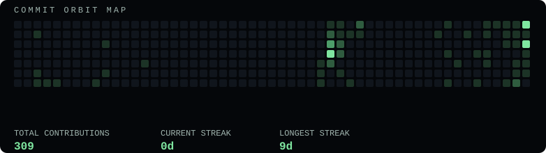

<div align="center">


</div>

<div align="center">


</div>

<br/>

<div align="center">

```text
══════════════════════════════════════════════════
             S T A R S H I P   J A N - 0 1
══════════════════════════════════════════════════
```

<sub>Electronics engineering student building practical systems at the intersection of software, hardware, and space.</sub>

| FIELD          | VALUE                                                   |
| -------------- | ------------------------------------------------------- |
| Commander      | Jargon                                                  |
| Mission        | Expand Human Intelligence through Engineering + Writing |
| Current Sector | Electronics Engineering — Space Systems Track           |
| Launch Year    | 2026                                                    |
| Mission Time   | T+ ongoing                                              |
| Comms Link     | [github.com/jhonristh](https://github.com/jhonristh)    |
| System Status  | 🟢 ONLINE                                               |

```text
══════════════════════════════════════════════════
```

</div>

<div align="center">

[Mission dashboard](#-mission-dashboard) · [Current missions](#-current-missions) · [Engineering bay](#-engineering-bay) · [Roadmap](#-galactic-roadmap) · [Open comms](#-open-comms)

</div>

---

## 🛰 Solar System Navigation

<div align="center">

</div>

Five primary builds hold the inner orbits — the closer the orbit, the faster it moves. Smaller missions drift in the outer belt.

| Orbit         | Body                         | What it is                                      | Class                          |
| ------------- | ---------------------------- | ----------------------------------------------- | ------------------------------ |
| 1 (innermost) | 🖼 I-ASCII                   | PNG → ASCII art converter                       | Signal Relay                   |
| 2             | 🚌 BUSINA                    | Jeepney fleet intelligence PWA                  | Flight Computer                |
| 3             | 📘 ECE Basics Companion      | Interactive ECE review modules                  | Knowledge Archive              |
| 4             | 🧠 RelAI                     | AI notification & attention platform            | AI Core                        |
| 5 (outermost) | 🧫 TRIHALOCEN                | Triple-concentric photobioreactor               | Research Laboratory            |
| Belt          | 📻 AM Receiver               | Transistor AM radio, from simulation to PCB     | Engineering Bay                |
| Belt          | 📄 ESG PDF Scorer            | Auto-scores company PDFs against the ESG/SDG rubric | Engineering Bay            |
| Belt          | 🧾 GabayNegosyo              | Website help for accounting students            | Communications                 |
| Belt          | ☄ Bulalakaw Station          | NASA Space Apps game                            | Flight Computer                |
| Belt          | 🛰 Satellite Pass Tracker    | Pass predictions with skyfield + Leaflet.js     | Navigation (planned)           |
| Belt          | 🪐 Orbital Mechanics Simulator | Euler / Verlet / RK4, n-body, Hohmann transfers | Navigation (planned)         |

---

## 📡 Commit Orbit Map

<div align="center">

</div>

<div align="center"><sub>Refreshed every 6 hours by <code>.github/workflows/commit-orbit.yml</code>. Green cells are energy output — the more contributions, the brighter the cell.</sub></div>

<details>
<summary><b>Open contribution signal trail</b></summary>
<br />
<div align="center">

</div>
</details>

---

## 📊 Mission Dashboard

<table>
<tr>
<td valign="top" width="60%">

```text
MISSION STATUS
────────────────────────────────────
Commander        Jargon
Current Sector   Electronics Engineering —
                 Space Systems Track
Mission Time     T+ ongoing
Missions         11 tracked (2 planned)
System Health    NOMINAL
────────────────────────────────────
CURRENT OBJECTIVE
  Advance toward Space Electronics —
  target: NASA / PhilSA engineering track

CURRENT LEARNING
  Circuit Theory · PCB Design ·
  Orbital Mechanics · Engineering Math
────────────────────────────────────
```

</td>
<td valign="top" width="40%" align="center">



</td>
</tr>
</table>

---

## 🚀 Current Missions

| Mission                  | Status      | Current phase                        | Repository                                                                    |
| ------------------------ | ----------- | ------------------------------------ | ----------------------------------------------------------------------------- |
| BUSINA                   | 🟢 Active   | Landing page + PWA infrastructure    | [BUSINA](https://github.com/jhonristh/BUSINA)                                 |
| RelAI                    | 🟡 Building | Core pipelines done, adapters next   | [RelAI](https://github.com/jhonristh/RelAI)                                   |
| TRIHALOCEN               | 🟡 Research | Reactor system designed              | [TRIHALOCEN](https://github.com/jhonristh/TRIHALOCEN)                         |
| ECE Basics Companion     | 🟢 Active   | MVP                                  | [ece-basics-companion](https://github.com/jhonristh/ece-basics-companion)     |
| I-ASCII                  | 🟢 Active   | Features + Tkinter/web UI            | [I-ASCII](https://github.com/jhonristh/I-ASCII)                               |
| AM Receiver              | 🟡 Building | Demodulator PCB routing              | [AM-Receiver](https://github.com/jhonristh/AM-Receiver)                       |
| ESG PDF Scorer           | 🟡 Building | CustomTkinter prototype              | [ESG-PDF-Scorer](https://github.com/jhonristh/ESG-PDF-Scorer)                 |
| GabayNegosyo             | 🟢 Active   | Website help for accounting students | [GabayNegosyo](https://github.com/jhonristh/GabayNegosyo)                     |
| Bulalakaw Station        | 🟢 Built    | NASA Space Apps game                 | [Bulalakaw-Station](https://github.com/jhonristh/Bulalakaw-Station)           |
| Satellite Pass Tracker   | 🔵 Planned  | Design stage                         | [Satellite-Pass-Tracker](https://github.com/jhonristh/Satellite-Pass-Tracker) |
| Orbital Mechanics Simulator | 🔵 Planned | Design stage                       | [Orbital-Mechanics-Simulator](https://github.com/jhonristh/Orbital-Mechanics-Simulator) |

---

## ⚙ Engineering Bay

```text
════════════════════════════════════════════
  ENGINEERING BAY — SYSTEM INVENTORY
════════════════════════════════════════════
```

### Languages


### Frameworks & Libraries


### AI / ML


<sub>Used in RelAI for cross-source notification deduplication.</sub>

### Hardware & EE Tools


### Software & Dev Environment


Coursework spans physics, calculus, material science, basic electronics, computer-aided drafting, and circuit theory — benchmarked against Young & Freedman, Boylestad, and Callister.

---

## 🧩 Installed Ship Modules

```text
CORE MODULES
────────────────────────────────────
[✓] Navigation
    Engineering Mathematics Knowledge Tree,
    satellite pass and orbital mechanics plans

[✓] Engineering Bay
    AM Receiver (SIMetrix, KiCad, breadboard),
    ESG PDF Scorer, CAD, ANSYS, Multisim

[✓] AI Core
    RelAI — categorization, dedup, natural-language ops

[✓] Knowledge Archive
    ECE Basics Companion — interactive concept review

[✓] Research Laboratory
    TRIHALOCEN photobioreactor,
    Sensory Substitution Devices review paper

[✓] Flight Computer
    BUSINA fleet intelligence, Bulalakaw Station game

[✓] Communications
    Writing & journalism, news writing group,
    GabayNegosyo, personal website

[✓] Signal Relay
    I-ASCII — image-to-ASCII conversion tool
────────────────────────────────────
```

---

## 🪵 Mission Log

```text
2026
✓ Entered Electronics Engineering — Space Systems Track
✓ Became frontend lead for BUSINA (team ALT-F4)
✓ Started RelAI — hackathon build
✓ Started ECE Basics Companion
✓ Started I-ASCII
✓ Began TRIHALOCEN photobioreactor research
✓ Built Bulalakaw Station — NASA Space Apps game
✓ Started GabayNegosyo — website help for accounting students
✓ Started AM Receiver — demodulator PCB now at routing
✓ Started ESG PDF Scorer — PUP ESG/SDG rubric
```

---

## 🌌 Galactic Roadmap

```text
NEXT SECTORS
────────────────────────
□ Embedded AI
□ Robotics
□ Space Electronics Research
□ NASA / PhilSA Pipeline
□ Startup
────────────────────────
```

---

## 🚀 Ignition

<div align="center">

</div>

---

## 🤖 AI Assistant

<table>
<tr>
<td valign="top" width="15%">

```text
   ___
  |o_o|
  |:_/ |
 //   \ \
(|     | )
/'\_   _/`\
\___)=(___/
```

</td>
<td valign="top" width="85%">

```text
> TRANSMISSION LOG

[T+0000] Boot complete. Commander authenticated.
[T+0012] BUSINA flight computer — nominal.
[T+0034] RelAI AI Core — dedup pipelines stable.
[T+0051] TRIHALOCEN — research phase ongoing.
[T+0077] AM Receiver — demodulator PCB at routing.
[T+0090] Outer belt: 6 smaller missions detected.
[T+0104] Recommend continued approach toward
         Space Electronics sector.

  — JAN-OS
```

</td>
</tr>
</table>

---

## 📡 Open Comms

| Channel      | Link                                                    |
| ------------ | ------------------------------------------------------- |
| GitHub       | [github.com/jhonristh](https://github.com/jhonristh)    |
| Repositories | [github.com/jhonristh](https://github.com/jhonristh)    |

---

## 🖥 Terminal

```text
C:\JAN-OS> status
ONLINE

C:\JAN-OS> modules
NAVIGATION · ENGINEERING BAY · AI CORE · KNOWLEDGE ARCHIVE
RESEARCH LAB · FLIGHT COMPUTER · COMMS · SIGNAL RELAY

C:\JAN-OS> missions
BUSINA · RelAI · TRIHALOCEN · ECE Basics Companion · I-ASCII
+ BELT: AM Receiver · ESG PDF Scorer · GabayNegosyo
        Bulalakaw Station · Satellite Pass Tracker · Orbital Sim

C:\JAN-OS> roadmap
EMBEDDED AI → ROBOTICS → SPACE ELECTRONICS → NASA/PhilSA → STARTUP

C:\JAN-OS> _
```

---

<div align="center">

_"The journey has only begun."_

</div>
